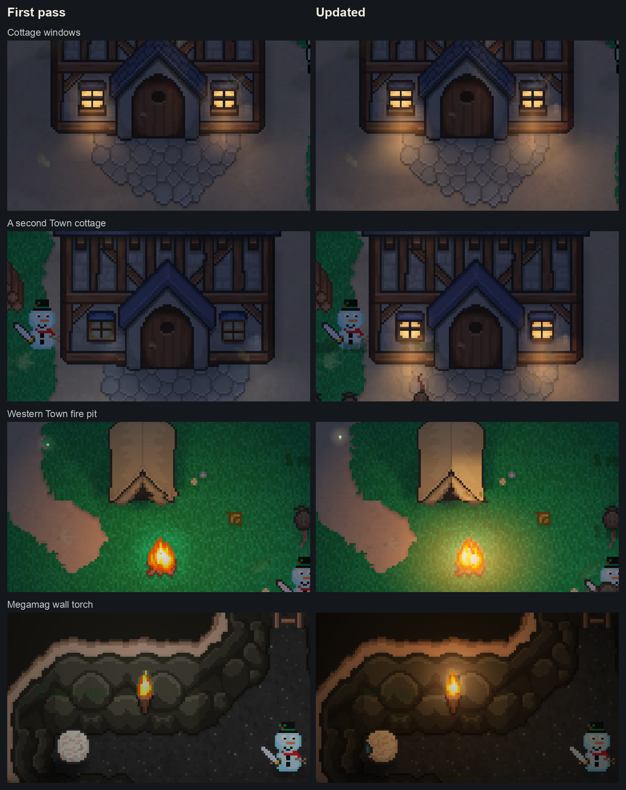
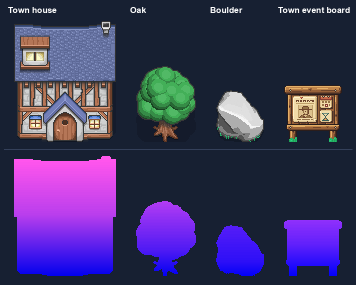
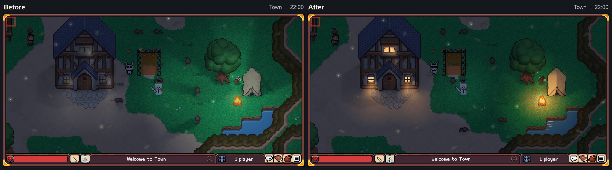
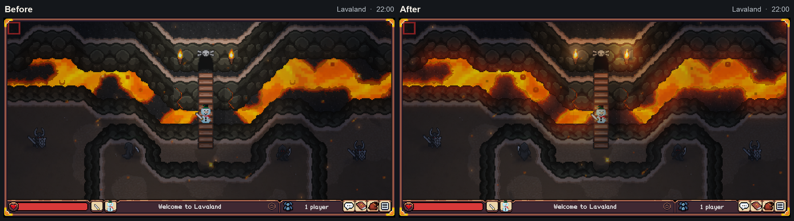

# Lights & shadows

Open **Lights & shadows** and choose a map. The map stays visible even when it has no lights. Choose **Torch**, **Lamp**, **Area light**, **Rectangle shadow** or **Polygon shadow**, then click the exact location on the map. A preview follows the pointer before placement. These are the map's actual Tiled `lights` and `shadows` object layers.

Light sources are invisible emitters. Place matching torch or lamp artwork separately in Tiled.

## Place and tune a light

Drag a light's circular marker to move it. Drag the round handle on its dashed radius ring to change its reach, or use **Radius (tiles)** beside the map. Changes to radius, intensity, color, animation and shadow strength update the lighting on the map itself. Selecting and saving objects preserves your current pan and zoom.

Drag empty map space to pan; hold Shift and drag to pan over an object or while placing. Scroll to zoom. **Focus on map** centers the selected object and its radius. **Fit map** shows the entire map. **Snap to tiles** places round lights in the middle of a tile and shadow blockers at a tile corner; turn it off for pixel placement. With the map focused, arrow keys move the selected object one tile, and Escape cancels placement or an active drag.

Use **Duplicate** to place a copy with the same settings at another location. Open **Map objects** to search existing sources and blockers. Exact coordinates and dimensions remain under **Coordinates & shape**. Round lights use their center; area lights and shadow blockers use their top-left origin. Polygon vertices are relative pixels; one tile normally equals 16 pixels.

Torches start with a warm fire flicker; lamps are steady. **Spotlight & falloff** contains the inner radius, beam spread and angle. A beam spread of 0 lights every direction. Radius controls take priority over the original ellipse bounds; **Use shape radius** under **Coordinates & shape** restores those bounds. The game uses whole tiles for radius and whole degrees for beams. Shrinking a light also keeps its inner radius within the new radius.

Area lights illuminate their rectangle with a uniform color. Use round lights for projected shadows and spotlights.

## Source glow

For a round light, open **Source glow** and set **Glow** to **On**. **Glow intensity** controls a warm, softly fading spill around the source artwork. The fire profile has a broader, brighter shoulder than steady windows, while both retain their authored radius and intensity. **Glow radius (pixels)** uses the original map pixels, independently of the light's radius in tiles; start around 12–24 pixels. The supported range is 1–64 pixels. **Glow color** can be warmer than the surrounding light. **Use light color** restores the source's regular light color.

Glow is off for existing lights until explicitly enabled. Area lights and directional spotlights do not support it; a round source must use a beam spread of 0 or 360 degrees. Keep the radius close to the flame, bulb or window so nearby roof tiles, characters and signs stay clear. The ordinary intensity and radius continue to control illumination of the ground and scenery.

When artwork already emits light through its tile properties, add a round source at the same pixel center and set its ordinary intensity and shadow strength to zero. Enable glow on that source to decorate only this placement without adding another light pool or changing every copy of the tile. A fire source can use the existing fire animation for an irregular, more noticeable glow pulse; turning off **Enable Dynamic Lights** or turning on **Reduced motion** holds it steady.

The Tiled properties are `glowIntensity` (0–1, absent or 0 disables glow), `glowRadius` (whole native pixels, default 16) and optional `glowColor` (`r,g,b`) and `glowTexture` (a PNG filename without its extension). They are saved and exported with the ellipse light object. Players can turn the effect off with **Light-source glow** in the game's graphics settings.

For a window or a light that falls across several materials, set **Light texture** to the name of a square RGBA PNG in `client/img/lighting/`. Paint the emission at native pixel resolution, with the emitter at its intended position in the square. A texture twice the **Glow radius** in width and height draws pixel for pixel. Transparent pixels preserve the original artwork, for example the dark wood between two lit panes. The texture supplies its own colors and fades into daylight. Ordinary point lighting still illuminates moving characters. When reusing a texture, check how its painted light lines up with the scenery at the new location.

Keep halos small when placing several sources together. Each view draws at most 16 glows and 30,720 native pixels of total halo area, counting the full square around each radius. Placed glows are considered first, followed by visible tile sources. A source that exceeds the remaining area budget is skipped and smaller sources can still fit. The three cottage windows and the nearby campsite use 16,704 pixels. The largest supported texture is 128 × 128 pixels.

### Reuse lighting from a tile

In Tiled, set `glowTexture`, `glowRadius` and `glowIntensity` on the tile that emits light. The ordinary light properties still control how far the light reaches actors and scenery. The glow follows every placement of that tile, including its animation. Use optional `glowOffsetX` and `glowOffsetY` to move the texture anchor from the tile center by up to 32 native pixels on either axis. A round source in the map’s lights layer at the same anchor overrides the tile glow. The six campsites with nearby tents use this to light the fire-facing canvas. Three camps reuse the same north-facing layout. The creek reflections belong to the eastern Town camp.

The main map uses these settings for the three windows on each of its 13 cottages, plus the mill, potion shop and forge windows. Nine campfires light nearby ground, 59 wall torches light the stone around their flames, and five small lanterns illuminate entrances and the forge wall. The beach’s two violet braziers use a matching light color. Use **Town · cottage windows**, **Desert · fire pit** and **Megamag · cave wall torches** in the preview launcher to inspect the different surfaces.

## Cast shadows

Place a rectangle or polygon blocker between a light and the area you want shaded. The blocker affects local lighting independently of collision and ambient light. Set that light's **Shadow strength** above 0 and enable **Show Others' Shadows** in the game's graphics settings.

Campfires, wall torches, windows and other round lights and spotlights cast indoors and outdoors. A blank **Shadow strength** uses the default. Set it to zero to turn off casting for that source. Moving characters cast on every map. On tilesets with a registered height atlas, local lights and sunlight use the same profiles for buildings, trees and scenery. Two lights on opposite sides of an object can illuminate each other's shadows. **Show Others' Shadows** controls scenery, mobs and other players. **Show Player Shadow** controls your own character's cast.

Firelight brightens and dims as the flame moves. The shadow is softest at its far edge, where the flicker is most visible. Disable **Enable Dynamic Lights** for a steady flame and shadow.

Edit polygon vertices as `x,y` pairs separated by spaces. For example, `0,0 32,0 32,32 0,32` makes a 2 × 2 tile box on a 16-pixel map. Move the whole polygon using Origin X/Y or map placement. Rotated and unsupported Tiled shapes remain available in Tiled.

When a polygon represents an existing height proxy, its optional Tiled property `proxyOwner` links the two. Use `tile:gid,dx,dy` for an atlas tile, with tile offsets from the polygon's origin cell, or `tree:dx,dy` for a layered tree, with pixel offsets from the rounded polygon origin to its root. The game uses the polygon when the linked caster is unavailable.

## Sun and moon shadows

In bounded outdoor scenes, profiled buildings, trees and props cast alongside moving characters. The sun follows the game clock. Low sun stretches the shadows, and moonlight casts a fainter shadow. In Scene manager, **Weather exposure → Outdoor** enables outdoor lighting. **Automatic** follows the scene's Tiled day/night flag. Indoor scenes use local emitters for projected light. [Scene settings](mapmaker-atmosphere.md)

Build the client with `node bin/build-client.js` and run `node bin/local-parallax-preview.js`. Open the printed launcher URL. In **Afternoon shadows**, compare the Town house and oak at 07:00 and 16:00 using **Time of day**. **Resume clock** restarts time. Use **Weather** beside the clock to compare **Clear**, **Cloudy**, **Rain** and **Sunrays** outdoors. Warm sunlit openings and cooler shaded patches move across the map together. Shadows soften in the covered patches and stay distinct in the sun. Cloud banks keep moving while the clock is held, and hold still with reduced motion. **Map weather** restores the scene’s authored weather. **Show shadow proxies** displays the visible height at each pixel, from blue at the ground to magenta higher up. In **Town · campfire at night**, walk around the flame to see the direction of the player's cast change.

Open Inventory with **Z** or Settings with **C** to see a panel cast onto the map. Panels share the light direction sampled at the player's feet. Scrub the outdoor clock or cross a nearby fire to change the cast direction.

### Town and Lavaland at 22:00

The two sides show the same camera, time and clear weather in the running browser game. The left side comes from `main` at `b417ab91c`. In Town, compare the cottage panes and the stones beneath them, then follow the campfire light across the near face of the tent to the creek.

In the local preview launcher, **Warm windows and campfire** starts at tile `(70, 222)`. **Source glow off** and **Source glow on** switch the painted emission for that session. The ordinary point lights use the colors set on the window and campfire tiles. Walk beside the fire to see its light on the player and the cast shadow change direction. [Watch the Town walk](images/town-firelight-walk.mp4)

| Source | Texture center in world pixels | Glow radius | Glow intensity |
| --- | --- | --- | --- |
| Cottage dormer | (1008, 3493) | 18 pixels | 0.98 |
| Cottage west window | (978, 3551) | 26 pixels | 0.96 |
| Cottage east window | (1037, 3551) | 26 pixels | 0.96 |
| Campfire | (1256, 3576) | 50 pixels | 0.92 |

In **Lavaland · bridge over lava**, start at tile `(71, 7)`. Light from exposed lava catches the nearby rock faces and bridge planks, then fades with distance. Look along the far wall to see how the dark crevices preserve the shape of the rocks. [Watch the bridge crossing](images/lavaland-bridge-walk.mp4)

**Duckville · tree shadows** starts at tile `(67, 437)`, directly below the tall bare tree. Its thin branches let light pass below them, and its wide roots meet the ground. **Duckville cave · firelit tree** starts at `(112, 428)`, beside the smaller bare tree and the existing fire at `(113.5, 427.5)`. These two tree profiles apply wherever their artwork is reused, including the alternate roots. The rest of Duckville's static artwork can use authored polygon blockers. [Duckville atlas](../client/img/common/height-proxies/duckville.png)

## Add height-aware scenery to another tileset

Open **Map & world → Scenery shadows** in the Mapmaker Toolbox, or follow the **Scenery shadows** link in **Lights & shadows**. Choose a map. Each copy of an object that uses the same tiles inherits its height profile, including copies on maps that share the tileset.

1. Under **Shadow bodies**, choose an existing object from the list or click its outline on the tilesheet. To create one, click **Add body**, drag tightly around the artwork, and give it a name. **Focus selection** zooms to the object.
2. Choose a shape and adjust **Front height**, **Ground depth** and **Roof slope**. Dimensions use the original tilesheet pixels. For a tree, choose **Rounded tree crown** and set its crown bottom and trunk span around the bark. The preview shows both the height proxy and its projected shadow. Move **Sun position** to check morning and afternoon contact at the feet or roots.
3. If the artwork already has a painted ground shadow, use **Paint removal** to mark its bounds. The baker removes translucent dark grey ink within those bounds. If a map has no outdoor gameplay scene, use **Outdoor areas** to mark its outdoor tiles on the map. These areas belong to the selected map. An authored scene takes precedence, so indoor rooms keep their own lighting.
4. Choose **Save changes** and start a fresh **Playtest**. Turn on **Show shadow proxies** to see the profiled surfaces in place. Scrub **Time of day** and move past a local light to inspect both casts. A profile save is immediately available in a new local session. To remove an object, select **Delete body** and save.

The Toolbox saves the editable source in `tools/maps/height_profiles/<tileset>.json` and bakes the corresponding images and catalog entry under `client/img/common/height-proxies/`. Commit these files together. The baker needs Python 3 with Pillow, which the local Toolbox image includes. Run `python3 tools/maps/generate_main_height_proxies.py --map <tileset> --check` to compare checked-in assets against the source artwork. [Profile sources](../tools/maps/height_profiles) · [Atlas generator](../tools/maps/generate_main_height_proxies.py)

The shadow playtest launcher includes these outdoor examples.

| Map | Spawn tile | Scenery to inspect |
| --- | --- | --- |
| DreamLand | (92, 140) | Blossom grove, cloud plaza oak and bridge lamps |
| Cob’s Farm | (24, 484) | Barn, orchard and pines |
| Cob’s Farm City | (77, 410) | Snowy town hall, gabled houses and winter trees |
| Taiko Town | (81, 156) | Park trees, streetlights and signs |

Moving characters use their current sprite frames. In the Forest, the parallax roots, trunk and canopy use their placed drawing positions for shadows. Maps without a registered terrain atlas can still use authored finite lights, moving-character casts and polygon blockers.

## Preview, save and playtest

The editor preview shows authored lights, spotlights and polygon blockers, including your unsaved draft. Use the game playtest to inspect height-proxy casts, moving characters and tile-emitted lights. **Preview darkness** helps inspect lights without changing the map atmosphere. Turn **Preview lighting** off to see the original artwork. Markers and radius rings are editor guides. The preview uses the last built artwork. Fire flicker pauses when reduced motion is enabled. Full-map lighting previews use lower resolution than close-ups.

Place several lights or blockers with the same preset, then choose Select / move to tune them. Switching objects preserves every edit. **Save all changes** writes all pending additions, edits and removals together in `tools/maps/tmx/<map>.tmx`, preserving unrelated map data and custom properties. The button shows the pending count. **Remove object → Delete object → Confirm deletion** stages a removal in that batch. Reloading or switching maps asks before discarding the whole draft. Invalid or stale saves keep every pending change available for correction.

Choose **Build this map**, wait for the build, then start a fresh local session. The regular map exporter includes these lights and blockers in the client map. Ambient light, the day/night cycle and tint remain in the [Scene manager](mapmaker-atmosphere.md).

Continue with [Building maps](mapmaker-building.md) and [Mapmaker Toolbox](mapmaker-toolbox.md).
